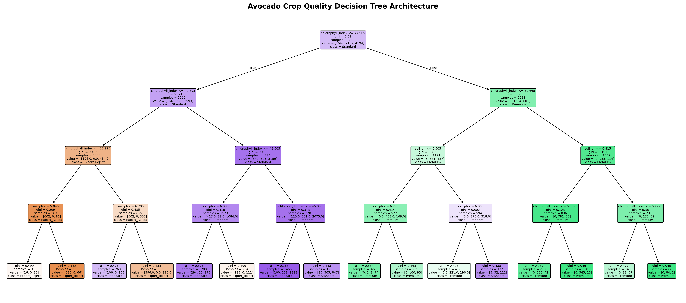
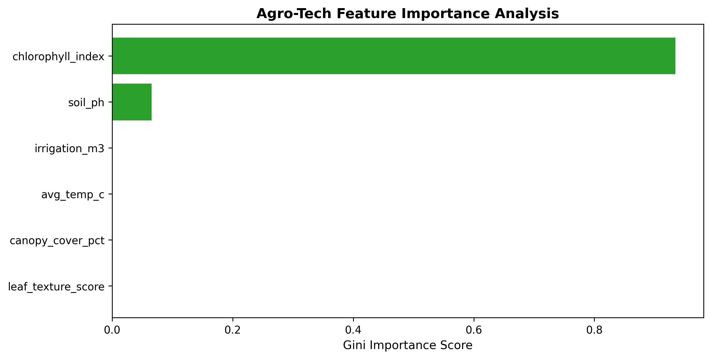

# 🥑 Big Data Agro-Tech Pipeline: Avocado Crop Yield & Quality Analytics

An end-to-end data analytics and machine learning pipeline processing over **10,000 agricultural field records**. This project integrates SQL database management, computer vision feature extraction, and machine learning classification to predict avocado harvest quality grades (`Premium`, `Standard`, `Export_Reject`).

---

## 🏗️ Architecture & Pipeline Flow

1. **SQL Data Engine (`SQLite` & `Pandas`):**
   - Built a relational database storing 10,000 synthetic records with soil metrics, climate readings, and regional data.
   - Implemented analytical SQL queries utilizing `GROUP BY`, `HAVING`, and `ORDER BY` aggregations.

2. **Computer Vision Feature Extraction (`skimage`):**
   - Simulated canopy cover percentage (`canopy_cover_pct`) and leaf texture edge scores (`leaf_texture_score`).
   - Merged heterogeneous data streams (SQL relational data + Image features) via `Pandas`.

3. **Machine Learning Model (`Scikit-Learn`):**
   - Trained a `DecisionTreeClassifier` (`max_depth=4`) achieving **75% accuracy** across 2,000 unseen test samples.
   - Extracted Gini feature importance indicating `chlorophyll_index` (93.4%) and `soil_ph` (6.6%) as primary quality drivers.

4. **Production Inference Engine:**
   - Implemented a real-time prediction pipeline returning quality classifications with confidence scores (e.g., **97.7% Premium confidence**).

---

## 📊 Results & Visualizations

### Decision Tree Architecture

### Feature Importance Breakdown

---

## 🛠️ Tech Stack & Dependencies

- **Language:** Python 3.10+
- **Database:** SQLite3, SQL
- **Data Engineering:** Pandas, NumPy
- **Machine Learning:** Scikit-Learn
- **Computer Vision:** Scikit-Image (`skimage`)
- **Visualization:** Matplotlib
